# td-native-inference

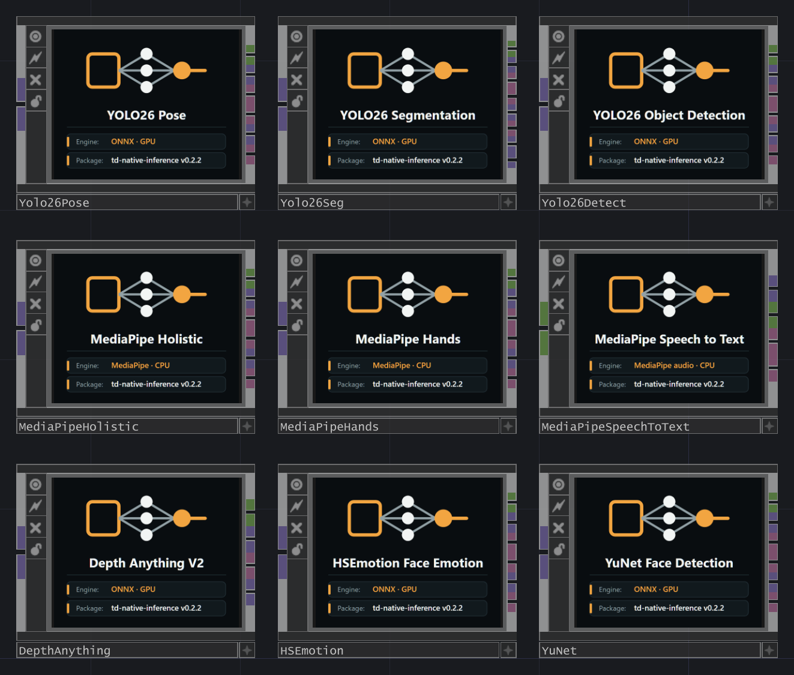

Native (C++) machine learning operators for TouchDesigner. Track hands, bodies, faces and objects,
segment people and estimate depth on live video; transcribe speech, speak text and recognize
sounds from audio.

The ONNX models run on the ONNX Runtime, CUDA and TensorRT that ship with TouchDesigner, and frames
stay on the GPU from the input TOP to the result. Nothing is copied to the CPU and back, and there's
no Python ML stack to install. The MediaPipe models (Google's own library, bundled) run on the CPU.

Each model is a ready-made `.tox`: drag it in, wire video (or audio) into it, and get a debug
image, tables with stable track ids, and CHOP channels. More detail on each:
[docs/MODELS.md](docs/MODELS.md). How the pieces fit together (wiring, tracking, latency, recipes):
[docs/MANUAL.md](docs/MANUAL.md).

## Requirements

- Windows 10 or 11 with an NVIDIA GPU.
- TouchDesigner **2025.32302 or later**, installed with the **Public ONNX** option (the ONNX models
  use TouchDesigner's own ONNX Runtime and TensorRT). Tested on 2025.33230.

## Install

1. Download `td-native-inference-vX.Y.Z.zip` from
   [Releases](https://github.com/cacheflowe/td-native-inference/releases) and extract it.
2. Copy its `td-native-inference` folder into `Documents\Derivative\Plugins\` (create `Plugins` if
   it doesn't exist). Restart TouchDesigner, and click **Allow** when it asks to load
   `OnnxTOP.dll`, `MediaPipeTOP.dll`, `MediaPipeCHOP.dll` and `TrackerDAT.dll`.
3. **Optional, for YOLO26, Robust Video Matting, DAViD and text to speech:** in the installed folder, double-click
   `fetch_models.cmd`. It downloads, checksum-verified, into the folder's `models\`:
   - **YOLO26** (about 90 MB). It's AGPL-3.0, so it isn't in the zip, and the script asks first.
   - **Robust Video Matting** (about 15 MB). It's GPL-3.0, so it isn't in the zip, and the script asks first.
   - **The Kokoro voice** for text to speech (about 280 MB).
   - **DAViD** (about 2.3 GB, MIT). The script asks first.

Keep the `tox` folder wherever you like, for example next to your projects.

**Updating:**
- Replace the installed `td-native-inference` folder with the new one, then restart TouchDesigner.
- Keep the old folder's `models\tts\`, `models\onnx\yolo26\`, `models\onnx\rvm\` and `models\onnx\david\`, or run `fetch_models.cmd` again.
- Replace the `.tox` files in your projects too: each tox expects the plugins of its own version (its **About** page shows which).

Install the plugins in **one** place per machine. That's either `Documents\Derivative\Plugins\`, or a `Plugins` folder next to a show's `.toe` (handy for a portable show machine), but not both: TouchDesigner would load two copies of the same operators.

## Models

| | Model | What it does |
|---|---|---|
| 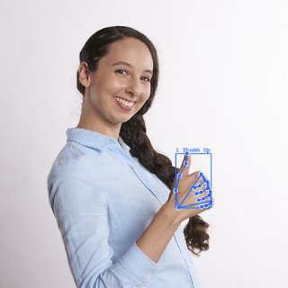 | **MediaPipe Hands** | Finds hands and the 21 joints of each finger, with depth. Gesture mode also names the hand shape (thumbs up, victory, open palm, ...) and flags the frame a gesture starts. |
| 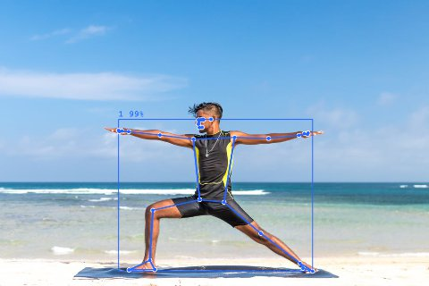 | **MediaPipe Pose** | A 33-point body skeleton (head, arms, hands, legs, feet) for a few people. |
| 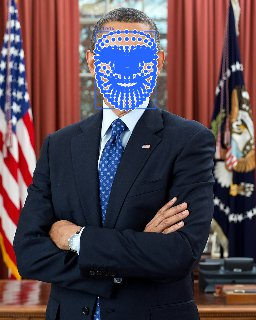 | **MediaPipe Face Landmarks** | A detailed 478-point face mesh, plus optional expression scores (smile, jaw open, blink, ...). |
| 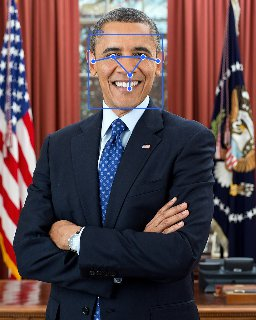 | **MediaPipe Face Detector** | Fast boxes around faces with 6 reference points. Use it when you need where faces are, not their shape. |
|  | **MediaPipe Holistic** | Body, both hands and the face of one person from a single model. |
| 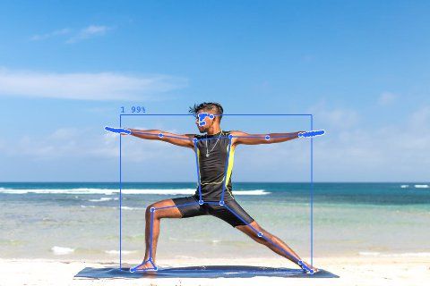 | **MediaPipe Holistic GPU** | The same models on the GPU through ONNX, in the background: a fraction of the CPU version's cost to TouchDesigner, one frame behind instead of two or more, several people, same output. Needs YOLO26 (`fetch_models.cmd`) to find people. |
| 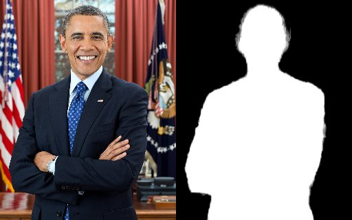 | **MediaPipe Segmentation** | A mask separating people from the background, like a green screen without the green. |
| 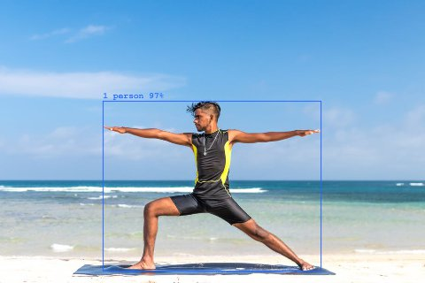 | **YOLO26 Object Detection** | Boxes around 80 kinds of everyday objects (people, cars, dogs, cups, ...), each labelled. |
| 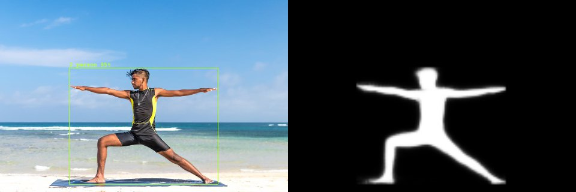 | **YOLO26 Segmentation** | Object detection plus a mask of each object's exact shape; optionally each tracked person or object in their own color, even where they overlap. |
| 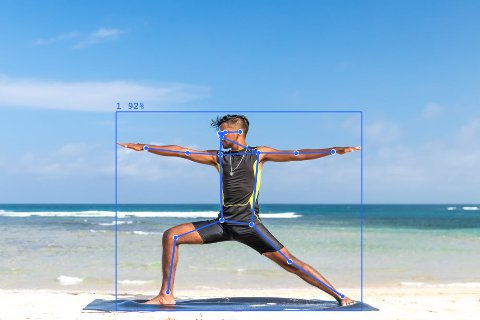 | **YOLO26 Pose** | 17-point skeletons for many people at once, on the GPU; good for crowds. |
|  | **MoveNet MultiPose** | Fast 17-point skeletons for up to 6 people, on the GPU. |
| 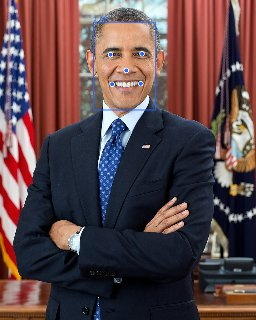 | **YuNet Face Detection** | Very fast face boxes with eye, nose and mouth points, plus which way each head is turned. |
| 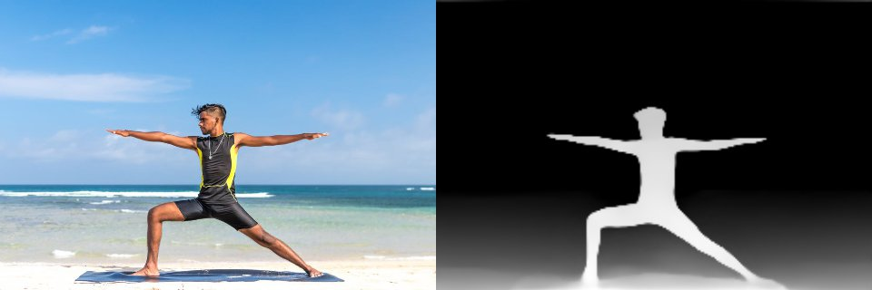 | **Depth Anything V2** | Estimates how far away everything in the frame is, from a single camera (near is bright). |
| 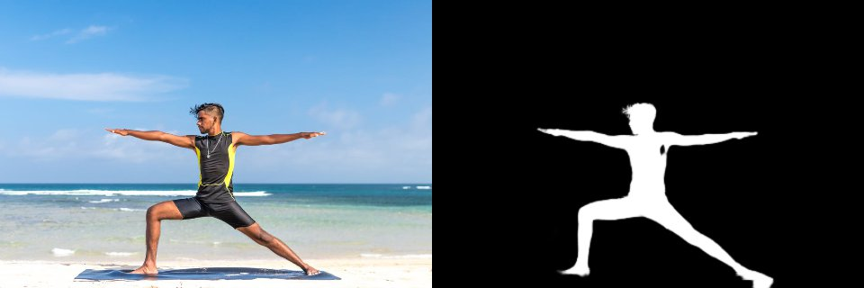 | **MODNet Portrait Matting** | Cuts a person out of the frame as an alpha matte, hair detail included. |
| 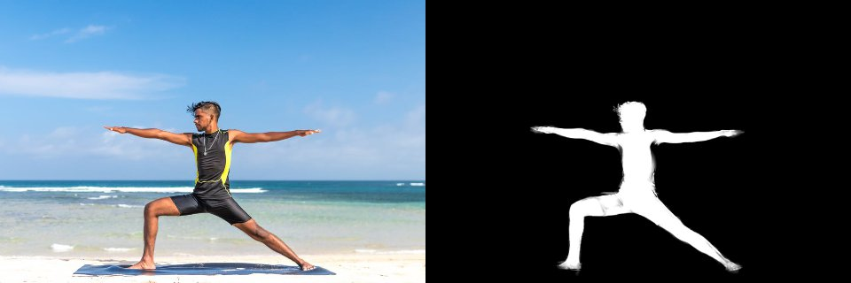 | **Robust Video Matting** | Cuts a person out of live video as an alpha matte, steadier than a per-frame matte when the subject moves fast. Downloaded by `fetch_models.cmd` (GPL-3.0). |
| 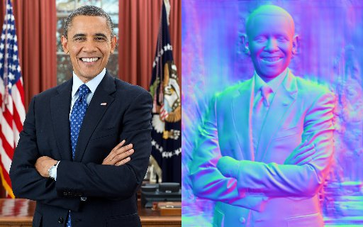 | **DAViD Normals / Matte** | A person's surface normals (for relighting) or a soft matte, from Microsoft's human-specific models. **DAViD Depth + Normals + Matte** gives depth, normals and matte from one larger model. Downloaded by `fetch_models.cmd` (2.3 GB). |
|  | **Mixamo Puppet** | Poses a Mixamo character from Holistic or Pose tracking and draws it over the video or on its own. You supply the character (FBX); see the [manual](docs/MANUAL.md#puppets). |
|  | **Hands Geometry** | Draws tracked hands as 3D spheres and cylinders (a POP plus a render). Needs TouchDesigner 2025 or later. |
|  | **HSEmotion** | Finds faces and scores each one for 7 emotions (happiness, surprise, anger, ...). |

### Audio

| | Model | What it does |
|---|---|---|
| 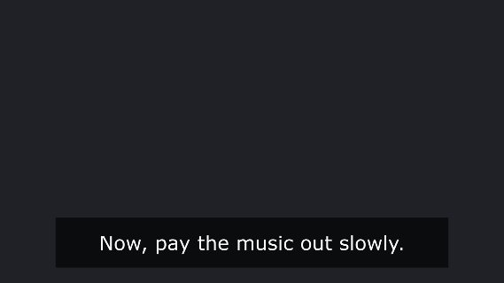 | **MediaPipe Speech to Text** | Turns speech from a mic or audio file into text as you talk, with a ready-made closed-caption image. |
| 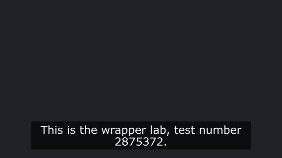 | **MediaPipe Text to Speech** | Speaks text in a natural voice (54 voices, 9 languages), from a parameter or any DAT; plays it or outputs it as audio. |
| 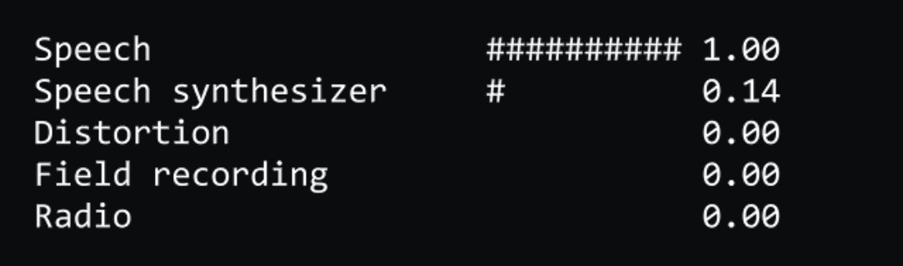 | **MediaPipe Sound Classifier** | Recognizes 521 kinds of sound (speech, music, clapping, dogs, sirens, ...) with a trigger when a chosen sound starts. |

The audio models run on the CPU.

The thumbnails are each model's debug output (video models: over their input, image results beside
it), generated by `tests/td_wrapper_lab.py` from the photos in `docs/images/sources/`. Every video
model also outputs a tracking table and CHOP channels; tracking is ByteTrack-style, in C++ (the
Tracker DAT, see [docs/MODELS.md](docs/MODELS.md#tracking)).

## Use

Drag any `.tox` from `tox/` into a network and wire a video TOP (Video Device In, Movie File In,
...) into it. It starts running right away, and its node shows which model it is.

- **TOP 1**: the debug overlay on a transparent background (or the result image, for segmentation
  and depth). Composite it over **TOP 2**, the input, to see it in place.
- **DAT 1** `tracks`: one row per tracked hand, person, face or object, with a stable `track_id`,
  its box and keypoints in 0–1 coordinates (origin bottom left).
- **CHOP**: the same values as channels (`t1_cx`, `t1_gesture_onset`, ...) plus status and timing.

The parameters are grouped on **Model**, **Tracking**, **Debug** and **About** pages.

Audio models take an audio CHOP instead (Audio Device In for a mic, Audio File In, ...); text to
speech takes text from its **Text** parameter or a DAT. Each one's outputs are listed in
[docs/MODELS.md](docs/MODELS.md#audio-models).

To try models side by side, use `VisionDemo.tox` or `AudioDemo.tox` and switch models on their
**Models** page.

The first run of each ONNX model builds a TensorRT engine in the background (a few minutes, lower
frame rate meanwhile); after that it loads in seconds.

## Troubleshooting

- **"The plugin required for this Custom OP was not found"**: the plugins aren't installed. Check
  that `Documents\Derivative\Plugins\td-native-inference\` contains the `.dll` and `.exe` files,
  then restart TouchDesigner.
- **TouchDesigner warns that plugins were found twice**: there's more than one `td-native-inference`
  install it can see (Documents and a project's `Plugins` folder). Remove one and restart.
- **No sound from text to speech**: **Play Audio** (Output page) uses the default audio device; to
  pick a device, turn it off and wire CHOP 1 into your own Audio Device Out.
- **"Model not found ... Looked for models/... in the project folder and in ..."**: the model isn't
  in the installed `models\` folder. For YOLO26 or text to speech, run `fetch_models.cmd`.
- **ONNX models run on CUDA with a TensorRT warning**: the engine is still building (the
  `trt_building` channel is 1), or an NVIDIA Background TOP loaded its own TensorRT first in this
  session; see [cpp/OnnxTOP/README.md](cpp/OnnxTOP/README.md).

## Development

The repo holds the plugins' C++ sources (`cpp/OnnxTOP`, `cpp/MediaPipeTOP`, `cpp/MediaPipeCHOP`),
the shared Python tracking code (`python/`), the debug visualizers (`tox/shared/`) and the dev
project `td-native-inference.toe`. Each model tox is generated from a spec in `wrappers/` by
`python/wrapper_builder.py`, with a node icon from `scripts/build_icons.py`.
[CLAUDE.md](CLAUDE.md) covers building, regenerating and testing; [docs/RELEASING.md](docs/RELEASING.md)
covers releases. Plugin parameters in depth: [cpp/OnnxTOP/README.md](cpp/OnnxTOP/README.md),
[cpp/MediaPipeTOP/README.md](cpp/MediaPipeTOP/README.md).

Building the plugins needs the CUDA Toolkit 12.x, CMake 3.24+, Ninja and an MSVC toolset your CUDA
supports (CUDA before 12.4 needs MSVC v142): run `cpp\OnnxTOP\build.cmd`,
`cpp\MediaPipeTOP\build.cmd` and `cpp\MediaPipeCHOP\build.cmd`. Models for a source checkout go in
`models/` (see [models/README.md](models/README.md)).

The build lands in `plugins/`, which TouchDesigner scans as the dev project's own Plugins folder. If a
release is also installed in `Documents\Derivative\Plugins\`, the dev project loads two copies of
each operator. `scripts\plugins.ps1` switches between them (close TouchDesigner first):

```
powershell -ExecutionPolicy Bypass -File scripts\plugins.ps1 dev       # move the installed binaries aside; use the project's plugins\ build
powershell -ExecutionPolicy Bypass -File scripts\plugins.ps1 install   # copy the local build into Documents\Derivative\Plugins\td-native-inference\
powershell -ExecutionPolicy Bypass -File scripts\plugins.ps1 status    # show which binaries are installed, set aside and built locally
```

Only the compiled files move. The installed `models\` folder stays where it is; `fetch_models.ps1`
manages it. `dev` puts the installed binaries in `Documents\Derivative\td-native-inference.disabled\`.
After `install`, TouchDesigner asks you to allow the new DLLs on its next launch. Run `dev` again
before reopening the dev project.

## License

Apache-2.0 (see [LICENSE](LICENSE)). Third-party software and models keep their own licenses,
listed in [NOTICE](NOTICE). YOLO26 is AGPL-3.0 and is not distributed here.
