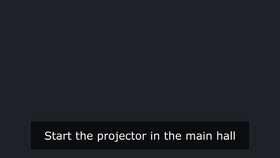

# td-native-inference

Native (C++) machine learning operators for TouchDesigner. Track hands, bodies, faces and objects,
segment people and estimate depth on live video, with no Python ML stack to install.

Each model is a ready-made `.tox`: drag it in, wire video into it, and get a debug overlay, a
tracking table with stable ids, and CHOP channels. More detail on each: [docs/MODELS.md](docs/MODELS.md).

## Models

| | Model | What it does |
|---|---|---|
|  | **MediaPipe Hands** | Finds hands and the 21 joints of each finger. Gesture mode also names the hand shape (thumbs up, victory, open palm, ...) and flags the frame a gesture starts. |
|  | **MediaPipe Pose** | A 33-point body skeleton (head, arms, hands, legs, feet) for a few people. |
|  | **MediaPipe Face Landmarks** | A detailed 478-point face mesh, plus optional expression scores (smile, jaw open, blink, ...). |
|  | **MediaPipe Face Detector** | Fast boxes around faces with 6 reference points. Use it when you need where faces are, not their shape. |
|  | **MediaPipe Holistic** | Body, both hands and the face of one person from a single model. |
|  | **MediaPipe Segmentation** | A mask separating people from the background, like a green screen without the green. |
|  | **YOLO26 Object Detection** | Boxes around 80 kinds of everyday objects (people, cars, dogs, cups, ...), each labelled. |
|  | **YOLO26 Segmentation** | Object detection plus a mask of each object's exact shape. |
|  | **YOLO26 Pose** | 17-point skeletons for many people at once, on the GPU; good for crowds. |
|  | **MoveNet MultiPose** | Fast 17-point skeletons for up to 6 people, on the GPU. |
|  | **YuNet Face Detection** | Very fast face boxes with eye, nose and mouth points, plus which way each head is turned. |
|  | **Depth Anything V2** | Estimates how far away everything in the frame is, from a single camera (near is bright). |
|  | **HSEmotion** | Finds faces and scores each one for 7 emotions (happiness, surprise, anger, ...). |

**Coming in v0.2: audio.** In this repo now, not yet in a release:

| | Model | What it does |
|---|---|---|
|  | **MediaPipe Speech to Text** | Turns speech from a mic or audio file into text as you talk, with a ready-made closed-caption image. Runs on the CPU. |

The thumbnails are each model's debug overlay over its input (image results beside it),
generated by `tests/td_wrapper_lab.py` from the photos in `docs/images/sources/`. Every model also outputs a tracking table and CHOP
channels; tracking is ByteTrack-style, in Python (see [docs/MODELS.md](docs/MODELS.md#tracking)).

## Requirements

- Windows 10 or 11 with an NVIDIA GPU.
- TouchDesigner **2025.32302 or later**, installed with the **Public ONNX** option (the ONNX models
  use TouchDesigner's own ONNX Runtime and TensorRT). Tested on 2025.33230.

## Install

1. Download `td-native-inference-vX.Y.Z.zip` from
   [Releases](https://github.com/cacheflowe/td-native-inference/releases) and extract it.
2. Copy its `td-native-inference` folder into `Documents\Derivative\Plugins\` (create `Plugins` if
   it doesn't exist). Restart TouchDesigner, and click **Allow** when it asks to load
   `OnnxTOP.dll` and `MediaPipeTOP.dll`.
3. **Optional, for the YOLO26 models:** YOLO26 is AGPL-3.0, so it isn't in the zip. In the
   installed folder, right-click `fetch_models.ps1` > **Run with PowerShell**. It downloads the
   three models (about 90 MB, checksum-verified) into the folder's `models\`.

Keep the `tox` folder wherever you like, for example next to your projects.

## Use

Drag any `.tox` from `tox/` into a network and wire a video TOP (Video Device In, Movie File In,
...) into it. It starts running right away.

- **TOP 1**: the debug overlay on a transparent background (or the result image, for segmentation
  and depth). Composite it over **TOP 2**, the input, to see it in place.
- **DAT 1** `tracks`: one row per tracked hand, person, face or object, with a stable `track_id`,
  its box and keypoints in 0–1 coordinates (origin bottom left).
- **CHOP**: the same values as channels (`t1_cx`, `t1_gesture_onset`, ...) plus status and timing.

The parameters are grouped on **Model**, **Tracking**, **Debug** and **About** pages. To try models
side by side, use `VisionDemo.tox` and switch models on its **Models** page.

The first run of each ONNX model builds a TensorRT engine in the background (a few minutes, lower
frame rate meanwhile); after that it loads in seconds.

## Troubleshooting

- **"The plugin required for this Custom OP was not found"**: the plugins aren't installed. Check
  that `Documents\Derivative\Plugins\td-native-inference\` contains the four `.dll`/`.exe` files,
  then restart TouchDesigner.
- **"Model not found ... Looked for models/... in the project folder and in ..."**: the model isn't
  in the installed `models\` folder. For YOLO26, run `fetch_models.ps1`.
- **ONNX models run on CUDA with a TensorRT warning**: the engine is still building (the
  `trt_building` channel is 1), or an NVIDIA Background TOP loaded its own TensorRT first in this
  session; see [cpp/OnnxTOP/README.md](cpp/OnnxTOP/README.md).

## Development

The repo holds both plugins' C++ sources (`cpp/OnnxTOP`, `cpp/MediaPipeTOP`), the shared Python
tracking code (`python/`), the debug visualizers (`tox/shared/`) and the dev project
`td-native-inference.toe`. Each model tox is generated from a spec in `wrappers/` by
`python/wrapper_builder.py`. [CLAUDE.md](CLAUDE.md) covers building, regenerating and testing;
[docs/RELEASING.md](docs/RELEASING.md) covers releases. Plugin parameters in depth:
[cpp/OnnxTOP/README.md](cpp/OnnxTOP/README.md), [cpp/MediaPipeTOP/README.md](cpp/MediaPipeTOP/README.md).

Building the plugins needs the CUDA Toolkit 12.x, CMake 3.24+, Ninja and an MSVC toolset your CUDA
supports (CUDA before 12.4 needs MSVC v142): run `cpp\OnnxTOP\build.cmd` and
`cpp\MediaPipeTOP\build.cmd`. Models for a source checkout go in `models/` (see
[models/README.md](models/README.md)).

## License

Apache-2.0 (see [LICENSE](LICENSE)). Third-party software and models keep their own licenses,
listed in [NOTICE](NOTICE). YOLO26 is AGPL-3.0 and is not distributed here.
